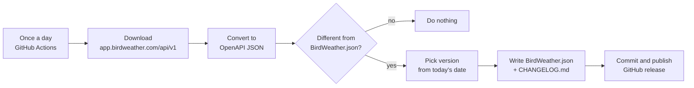

<div align="center">

# BirdWeather OpenAPI

**An always-current, unofficial OpenAPI 3 spec for the BirdWeather REST API, with a changelog and a GitHub release every time BirdWeather changes something.**

[](https://github.com/Celerium/BirdWeather-OpenAPI/actions/workflows/tests.yml)
[](https://github.com/Celerium/BirdWeather-OpenAPI/actions/workflows/watch-birdweather-api.yml)
[](https://github.com/Celerium/BirdWeather-OpenAPI/releases/latest)


[Get the spec](#-get-the-spec) · [How it works](#-how-it-works) · [Run it yourself](#-run-it-yourself) · [Tests](#-tests) · [Changelog](CHANGELOG.md)

</div>

---

BirdWeather documents its REST API at <https://app.birdweather.com/api/v1> but does not publish an OpenAPI spec,
and it does not announce changes. This project fixes that:

- 📄 **Converts** the documentation into [`BirdWeather.json`](BirdWeather.json), an OpenAPI 3.0.3 document.
- 🔍 **Watches** the documentation once a day and records exactly what changed (endpoints, parameters, request bodies, response fields).
- 🏷️ **Releases** a new GitHub release with human-readable release notes whenever the API changes.
- 🧪 **Tested**: unit tests run on every push, and the committed spec is validated as OpenAPI.

> [!NOTE]
> This is a best-effort, community project. It is not published, maintained or endorsed by BirdWeather.
> The spec reflects what the documentation says, which is not always what the live API does.
> (For example the live API returns a few fields the documentation does not mention.)

> [!NOTE]
> The [GraphQL documentation](https://app.birdweather.com/api/index.html) is out of scope. GraphQL APIs describe
> themselves through introspection, so they do not need an OpenAPI spec.

## 📦 Get the spec

| What you want | Where |
| --- | --- |
| Latest spec | [`BirdWeather.json`](https://raw.githubusercontent.com/Celerium/BirdWeather-OpenAPI/main/BirdWeather.json) on `main` |
| A specific version | Download `BirdWeather.json` from a [release](https://github.com/Celerium/BirdWeather-OpenAPI/releases) |
| What changed and when | [Releases](https://github.com/Celerium/BirdWeather-OpenAPI/releases) or [`CHANGELOG.md`](CHANGELOG.md) |
| Get notified of changes | **Watch → Custom → Releases** on this repository |

Point any OpenAPI tool at the raw URL: Swagger UI, Postman, Insomnia, `openapi-generator`, Kiota, and so on.

## 🏷️ Versioning

BirdWeather publishes no API changelog, only a major version (`V1`) in the page text. The spec version is therefore
`<API version>.<date the change was detected (UTC)>`:

| Situation when the API change is detected | Spec version |
| --- | --- |
| First change on a given day | `1.20261114` |
| A second change on the same day | `1.20261114.2` |

## ⚙️ How it works



- The comparison ignores `info.version`, so a quiet day never rewrites the file or creates a commit.
- Safety net: if a run would shrink the spec by more than half, or the page no longer contains any endpoints, it is
  treated as a broken scrape and the run fails instead of overwriting the spec.
- The workflow lives in [`.github/workflows/watch-birdweather-api.yml`](.github/workflows/watch-birdweather-api.yml).
  It runs once a day and can also be started manually from the **Actions** tab (with an optional *force* switch).
  [`tests.yml`](.github/workflows/tests.yml) runs the unit tests, the linter and the OpenAPI validation.

### What the converter extracts

- Every documented route, grouped by resource group (as tags), with summaries and descriptions
- Path and query parameters with types, enums, defaults, maximums, examples and required flags
- Request bodies (JSON and form-encoded) from the field lists and examples, plus the raw audio upload
- Every documented response (`200`, `201`, `404`, `422`, ...), with schemas inferred from the examples
- Servers, support contact, and the station-token / administrator-token authentication model

Examples in the BirdWeather page are sometimes not valid JSON (`...` placeholders, `045`); the parser repairs
these instead of dropping the response.

## 🚀 Run it yourself

You need **Python 3.10 or newer**. Nothing is sent anywhere except a `GET` request to BirdWeather's public documentation.

```bash
git clone https://github.com/Celerium/BirdWeather-OpenAPI.git
cd BirdWeather-OpenAPI
python -m venv .venv
```

```powershell
# Windows (PowerShell)
.\.venv\Scripts\Activate.ps1
```

```bash
# macOS / Linux
source .venv/bin/activate
```

```bash
pip install -e .
```

Write to a scratch file so the tracked `BirdWeather.json` is left alone:

```bash
birdweather-openapi --output my-birdweather.json --no-changelog
```

```text
Wrote my-birdweather.json: version 1.20261114 (12 operations; 12 added, 0 removed, 0 modified).
```

Running the same command again reports `No API changes detected` and leaves the file untouched.

| Option | What it does |
| --- | --- |
| `--output PATH` | OpenAPI JSON file to create or update (default `BirdWeather.json`) |
| `--dry-run` | Show what would change without writing anything |
| `--no-changelog` | Do not touch `CHANGELOG.md` |
| `--changelog PATH` | Changelog to update (default `CHANGELOG.md`) |
| `--release-notes-file PATH` | Save markdown release notes here when something changed |
| `--force` | Write even if nothing changed, or if the safety net tripped |
| `--github-output PATH` | Append `changed`, `version`, `tag`, ... for GitHub Actions |
| `--source-url URL` | Read the documentation from somewhere else (for example a saved copy) |

`python -m birdweather_openapi` works the same as the `birdweather-openapi` command.

## 🧪 Tests

```bash
pip install -e ".[dev]"
pytest          # unit tests, no network needed
ruff check .    # lint
```

The unit tests use saved HTML ([`tests/fixtures`](tests/fixtures)), so they never call BirdWeather. They cover
parsing, schema inference, the OpenAPI output (validated with `openapi-spec-validator`), version selection, change
detection, the changelog and the command line.

### Live tests (optional)

[`tests/test_live.py`](tests/test_live.py) makes read-only `GET` requests with a real station token and checks that
live responses still have the types the generated spec documents. They are skipped unless you opt in. Never commit
the token; pass it through the environment:

```powershell
$env:BIRDWEATHER_STATION_TOKEN = "<station token>"
$env:BIRDWEATHER_STATION_ID    = "<station id>"   # optional
pytest -m live
```

## 🗂️ Repository layout

| Path | Purpose |
| --- | --- |
| [`BirdWeather.json`](BirdWeather.json) | The generated OpenAPI spec |
| [`CHANGELOG.md`](CHANGELOG.md) | One entry per detected API change |
| [`birdweather_openapi/`](birdweather_openapi) | The converter: `parser` → `schema` → `builder` → `tracker` (+ `versioning`, `diff`, `cli`) |
| [`tests/`](tests) | Unit tests, live tests and HTML fixtures |
| [`.github/workflows/`](.github/workflows) | `tests.yml` (CI) and `watch-birdweather-api.yml` (daily watcher and releases) |

## 🤝 Contributing

Found a parameter that is typed wrong or a page the parser misses? Open an issue or a pull request. Add a small
HTML snippet to `tests/fixtures/mini.html` and a test that fails without your fix.
